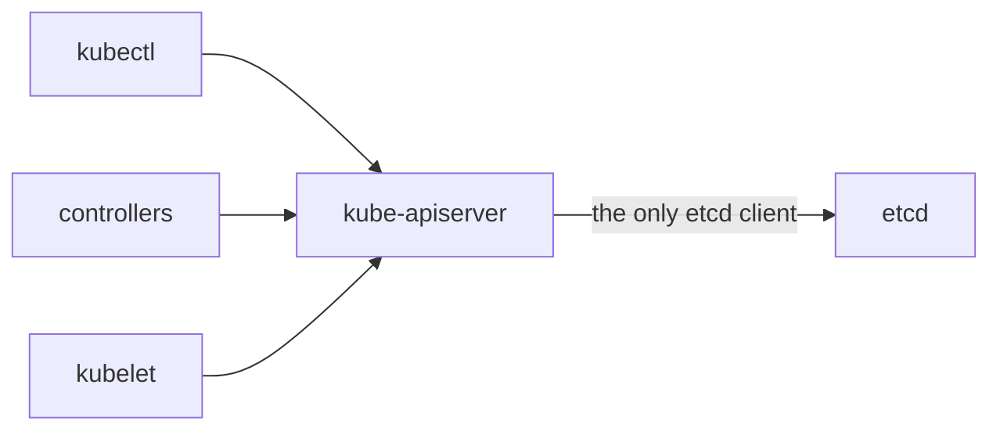
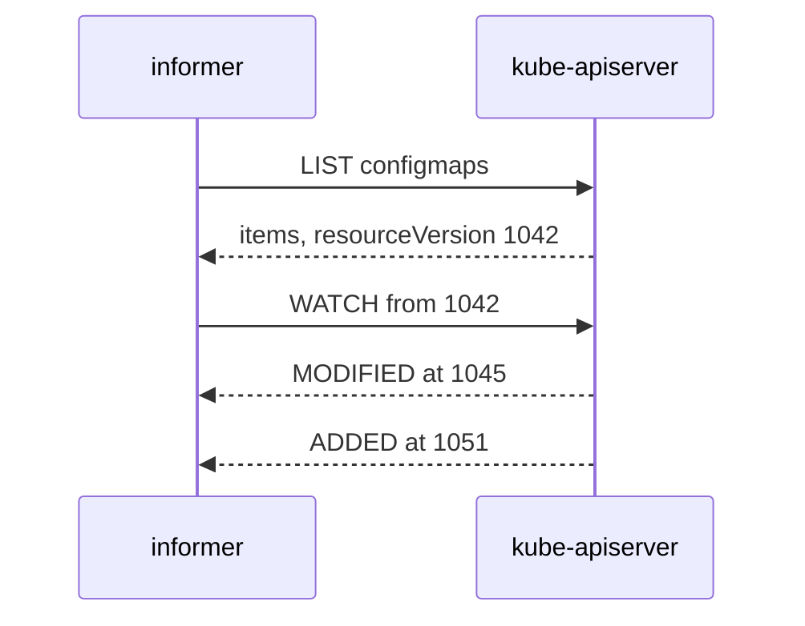

$whoami
---

<!-- no_footer -->

```yaml +no_background
Name:   Gaurav Gahlot
Role:   Staff Software Engineer @IONOS Cloud
X:      @_gauravgahlot
GitHub: gauravgahlot
Web:    https://gauravgahlot.in/
OSS:
  - Akri (maintainer, CNCF Sandbox)
  - kube-dra (slow WIP)
  - Tinkerbell
  ...
```

<!-- end_slide -->

<!-- no_footer -->

A Simple Question
---

📌 A ConfigMap is a small Kubernetes object that holds settings for an app.

```yaml
apiVersion: v1
kind: ConfigMap
metadata:
  name: app-config
  resourceVersion: "3012506"
data:
  color: blue
```

📌 How many times was this ConfigMap written?

<!-- end_slide -->

<!-- no_footer -->

What We Already Know
---

```text +no_background
$ git push
 ! [rejected]        main -> main (fetch first)
error: failed to push some refs to '...'
hint: Updates were rejected because the remote contains work that you do not
hint: have locally. This is usually caused by another repository pushing to
hint: the same ref. ...
```

📌 Someone pushed first. Your copy was out of date, so git refused it.

📌 Kubernetes refuses stale writes the same way. The number it checks is `resourceVersion`.

<!-- end_slide -->

<!-- no_footer -->

Kubernetes in One Slide
---

```yaml +no_background
object: a record of what you want, like a Deployment or a ConfigMap
namespace: a named group of objects inside one cluster
kubectl: the command-line client you use to read and write objects
API server: the front door; every read and write goes through it
controller: a loop that reads objects and changes the cluster to match them
etcd: the database that stores every object
```

📌 You write objects. Controllers make them true. etcd remembers all of it.

<!-- end_slide -->

<!-- no_footer -->

etcd · One Sorted Map
---



📌 Keys and values are bytes, kept in sorted order.

📌 Only the API server talks to etcd.

<!-- end_slide -->

<!-- no_footer -->

Demo · Your Objects Are Keys
---

```sh
/registry/<resource>/<namespace>/<name>
```

```sh
$ etcdctl get /registry/configmaps/default/ --prefix --keys-only
```

📌 Listing the ConfigMaps in a namespace scans every key with that prefix.

<!-- end_slide -->

<!-- no_footer -->

etcd · One Counter
---

📌 One counter for the whole store, called the **revision**.

📌 It is a logical clock: it orders writes, it does not tell time.

📌 Every write, anywhere, adds one. Reads don't.

```text {1|2|3}
rev 5   put  /a
rev 6   put  /z     an unrelated key moves it too
rev 7   put  /a
```

<!-- end_slide -->

<!-- no_footer -->

Demo · Nobody Is Touching It
---

```sh
$ etcdctl endpoint status -w json | jq '.[0].Status.header.revision'

$ sleep 30; etcdctl endpoint status -w json | jq '.[0].Status.header.revision'

$ etcdctl put /not-kubernetes/hello world -w json | jq '.header.revision'
```

📌 A lease is a small object a component rewrites every few seconds, to show it is still alive.

<!-- end_slide -->

<!-- no_footer -->

etcd · Four Numbers per Key
---

```sh
$ etcdctl get /registry/configmaps/default/app-config -w json | jq ...
```

```text {1|2|3|4}
revision            the whole store's counter, right now
create_revision     when this key was created
mod_revision        the last write to this key
version             how many times this key was written
```

<!-- end_slide -->

<!-- no_footer -->

etcd · resourceVersion Is mod_revision
---

```sh
$ kubectl get configmap app-config -o jsonpath='{.metadata.resourceVersion}'
```

📌 `version` is the number you thought it was. Kubernetes never shows it.

<!-- end_slide -->

<!-- no_footer -->

Demo · A Noisy Neighbour
---

```sh
$ kubectl apply -f noisy-producer.yaml          # ~146 writes a second


$ kubectl get configmap app-config -o jsonpath='{.metadata.resourceVersion}'

$ kubectl patch configmap app-config --type merge -p '{"data":{"color":"purple"}}'

$ kubectl get configmap app-config -o jsonpath='{.metadata.resourceVersion}'
```

📌 A Job runs a program inside the cluster. This one rewrites one ConfigMap in a loop.

<!-- end_slide -->

<!-- no_footer -->

The Answer
---

📌 Every namespace. Every lease. Every status update.

📌 Every cluster that shares that etcd.

📌 **One clock for the whole etcd cluster.**

<!-- end_slide -->

<!-- no_footer -->

Optimistic Concurrency · 409
---

📌 Every update is a compare-and-swap on `mod_revision`:

```text {1-2|3-4}
if mod_revision(key) == 594:
    put(key, new object)
else:
    fail                      → 409 Conflict
```

📌 No locks. The loser re-reads and retries.

<!-- end_slide -->

<!-- no_footer -->

Demo · Two Writers, One Stale
---

```sh
$ kubectl get configmap app-config -o yaml > app-config.yaml

$ kubectl patch configmap app-config --type merge -p '{"data":{"color":"yellow"}}'

$ kubectl replace -f app-config.yaml
```

```text +no_background
Error from server (Conflict): error when replacing "app-config.yaml":
Operation cannot be fulfilled on configmaps "app-config": the object has been
modified; please apply your changes to the latest version and try again
```

📌 The content never mattered. Only the `resourceVersion` did.

<!-- end_slide -->

<!-- no_footer -->

MVCC · Nothing Is Overwritten
---

📌 **M**ulti-**V**ersion **C**oncurrency **C**ontrol: a write adds a version. The old one stays.

```text {1|2|3-6|7}
/registry/configmaps/default/app-config
  version 1   color: blue        created
  version 2   color: green
  version 3   color: red
  version 4   color: purple
  version 5   color: yellow
  tombstone                      deleted
```

📌 A tombstone is a marker that says the key was deleted at that revision.

<!-- end_slide -->

<!-- no_footer -->

MVCC · Why Keep History?
---

```yaml +no_background
reads: served at one revision, so nobody waits for a lock
watches: replay from any revision that is still kept
lists: one consistent snapshot, never half old and half new
```

📌 A watch is a live stream of changes, starting from a revision you choose.

📌 The cost comes later.

<!-- end_slide -->

<!-- no_footer -->

Demo · Reading the Past
---

```sh
$ kubectl delete configmap app-config

$ etcdctl get /registry/configmaps/default/app-config

$ etcdctl get /registry/configmaps/default/app-config --rev=$CREATED --print-value-only | strings
```

📌 Deleted, and still on disk.

<!-- end_slide -->

<!-- no_footer -->

Demo · An Object's Whole Life
---

```sh
$ etcdctl watch /registry/configmaps/default/app-config --rev=$CREATED -w json | jq -c ...
```

```text {1|2-5|6}
{"event":"PUT","version":1}
{"event":"PUT","version":2}
{"event":"PUT","version":3}
{"event":"PUT","version":4}
{"event":"PUT","version":5}
{"event":"DELETE","version":0}
```

📌 A delete is a write. It took a number too.

<!-- end_slide -->

<!-- no_footer -->

List, Then Watch
---



📌 An informer is how a controller keeps a local copy of objects: list once, then watch.

📌 The list's resourceVersion is where the watch picks up. No gap, no repeat.

<!-- end_slide -->

<!-- no_footer -->

The Bridge
---

| In Kubernetes               | In etcd                            |
| --------------------------- | ---------------------------------- |
| an object's resourceVersion | that key's `mod_revision`          |
| a list's resourceVersion    | the revision the range was read at |
| `watch?resourceVersion=N`   | a watch from revision N            |
| `409 Conflict`              | the `mod_revision` check failed    |
| `410 Gone`                  | that history is no longer kept     |

<!-- end_slide -->

<!-- no_footer -->

The Price · Compaction
---

📌 History grows even when your objects don't.

📌 So old versions get thrown away:

```sh
kube-apiserver --etcd-compaction-interval=5m     # the default
etcdctl compact <revision>                       # by hand
```

<!-- end_slide -->

<!-- no_footer -->

Demo · 410 Gone
---

```sh
$ etcdctl compact $REV
$ etcdctl get /registry/configmaps/default/app-config --rev=$CREATED
Error: etcdserver: mvcc: required revision has been compacted
```

```sh
$ kubectl get --raw "/api/v1/namespaces/default/configmaps?watch=1&resourceVersion=$BEFORE"
```

```text +no_background
{"type":"ERROR","object":{"kind":"Status", ...
 "message":"too old resource version: ...","reason":"Expired","code":410}}
```

<!-- end_slide -->

<!-- no_footer -->

410 Gone · Two Windows
---

📌 etcd keeps history back to its last compaction.

📌 The API server keeps its own window: at least about 75 seconds per resource.

📌 The 410 you just saw came from the API server's window.

📌 Fall out of either one and you get `410`. Your informer re-lists. It is not a bug.

<!-- end_slide -->

<!-- no_footer -->

Compaction ≠ Defrag
---

```text {1-2|3|4}
                    file on disk    live data
before                 14.7 MB       14.7 MB
etcdctl compact        14.7 MB        0.6 MB
etcdctl defrag         0.55 MB       0.54 MB
```

📌 Compaction frees space inside the file. Only defrag gives it back.

<!-- end_slide -->

<!-- no_footer -->

Defrag · It Blocks
---

📌 A 378 MB database, on this laptop:

```text +no_background
   defrag                 604 ms
   a read during it       632 ms      normally 46 ms
   a write during it      632 ms      normally 46 ms
```

📌 That etcd server serves nothing until it finishes.

<!-- end_slide -->

<!-- no_footer -->

What a Long Defrag Costs
---

📌 One nightly defrag took 8 seconds.

📌 On another cluster, it took 43.

📌 A controller runs several copies, and a lease decides which one leads. That lease lasts 15 seconds.

<!-- end_slide -->

<!-- no_footer -->

Why Only One Resource Type?
---

📌 Events are the status messages you see in `kubectl describe`.

📌 The API server can keep them in a different etcd:

```sh
kube-apiserver --etcd-servers-overrides=/events#https://events-etcd:2379
```

📌 Two etcds. Two clocks.

<!-- end_slide -->

<!-- no_footer -->

Takeaways
---

📌 `resourceVersion` is etcd's revision: one counter for the whole store.

📌 It is the key's `mod_revision`, not a count of your writes.

📌 `409` is the `mod_revision` check. `410` is history that is gone.

📌 Compaction throws history away. Only defrag shrinks the file, and it blocks.

<!-- end_slide -->

<!-- no_footer -->

Try It Tonight
---

📌 Everything you saw runs on one laptop: Docker, kind, kubectl, etcdctl and jq.

```text +no_background
github.com/gauravgahlot/talks
  2026/11/devfest_what_resourceversion_really_is_demo.md
```

<!-- end_slide -->

<!-- no_footer -->

Thank you! 🙇🏻
---

Slides:

- [Web](https://gauravgahlot.in/talks)
- [GitHub](https://github.com/gauravgahlot/talks)
- [Try it tonight](https://github.com/gauravgahlot/talks/blob/main/2026/11/devfest_what_resourceversion_really_is_demo.md)

References:

- [Kubernetes API concepts: resource versions](https://kubernetes.io/docs/reference/using-api/api-concepts/#resource-versions)
- [etcd data model](https://etcd.io/docs/v3.6/learning/data_model/)
- [etcd maintenance: compaction and defragmentation](https://etcd.io/docs/v3.6/op-guide/maintenance/)
